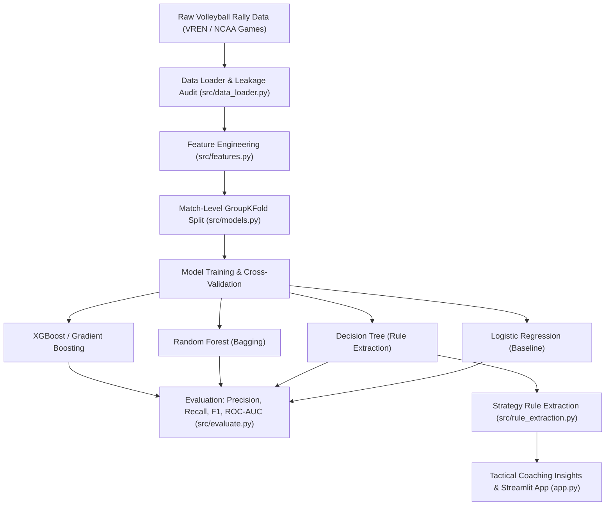

# Volleyball Attack Strategy Prediction and Tactical Discovery Using Machine Learning

**Course**: CMPE 257 Machine Learning (Fall 2026)  
**Author**: Raj Dharmendra Kadvani (Student ID: 018283798)  
**Institution**: San Jose State University  
**Instructor**: Prof. Zara Hajihashemi  
**Teaching Assistant**: Aditya Hegde  

---

## Project Overview

In volleyball, an attack point (kill) rarely comes from an isolated hit. Instead, the outcome depends on a connected sequence of actions: how well the ball was passed (in-system vs out-of-system), what type of set was delivered, the attacker's court zone, and how many opponent blockers are contesting at the net.

While coaches traditionally spend hours reviewing match video to spot tendencies, manual scouting is time-consuming and makes it hard to systematically evaluate multi-action combinations across matches.

The goal of this project is to apply machine learning to structured volleyball rally data in order to:
1. Predict whether an attack sequence will result in a point (attack success / kill).
2. Compare linear baselines against non-linear tree ensembles using match-level cross-validation to prevent data leakage.
3. Extract interpretable, high-precision strategy rules from decision trees that coaches and players can use for tactical match preparation.

This project is inspired by the research by Jan Van Haaren et al., *"Analyzing Volleyball Match Data from the 2014 World Championships Using Machine Learning Techniques"* (ACM SIGKDD 2016), adapted to open structured rally data from the VREN dataset.

---

## Dataset

This project uses structured rally possession data based on the open-source **VREN (Volleyball Rally Dataset with Expression Notation Language)** [Xia et al., arXiv:2209.13846], which documents indoor volleyball matches from NCAA Division I and international games.

### Feature Summary

| Feature Name | Type | Description |
|---|---|---|
| `match_id` | Categorical | Unique match identifier (used for GroupKFold cross-validation) |
| `rally_id` | Integer | Rally index within each match |
| `round` | Integer | Possession round within rally (1 = serve receive attack, 2+ = transition) |
| `team` | Categorical | Attacking team identifier (`Team_A`, `Team_B`) |
| `serve_type` | Categorical | Serve technique (`Jump_Serve`, `Float_Serve`, `Topspin`) |
| `pass_rating` | Ordinal | Reception quality (`1 = Poor / Out-of-system`, `2 = Medium`, `3 = Perfect / In-system`) |
| `set_type` | Categorical | Set trajectory and tempo (`Quick`, `Outside`, `Slide`, `Pipe`, `High_Ball`, `Opposite`) |
| `set_zone` | Categorical | Net zone where set was placed (`Zone_2`, `Zone_3`, `Zone_4`) |
| `attack_type` | Categorical | Hitter stroke technique (`Hard_Spike`, `Tip`, `Roll_Shot`, `Tool_Block`, `Off_Speed`) |
| `attack_zone` | Categorical | Court zone of the attack (`Zone_1` to `Zone_6`) |
| `num_blockers` | Integer | Number of opposing blockers at the net (`0`, `1`, `2`, `3`) |
| `block_touch` | Binary | Whether the defensive block touched the ball (`0 = No`, `1 = Yes`) |
| **`attack_success`** | **Binary (Target)** | **Possession outcome (`1 = Point Won / Kill`, `0 = Defended / Point Lost`)** |

**Data Leakage Prevention**: Features encoding terminal rally outcomes (such as error classifications, referee whistle reasons, or post-rally tags) are explicitly excluded from the feature matrix so models only train on information available before the attack concludes.

---

## Project Pipeline



---

## Feature Engineering

To capture domain knowledge from volleyball gameplay, several engineered features were created in `src/features.py`:
- `is_in_system`: Binary indicator for `pass_rating == 3` (perfect pass allowing all offensive tempo options).
- `is_out_of_system`: Binary indicator for `pass_rating == 1` (forces high-ball sets to the outside pins).
- `is_quick_attack`: Indicates fast-tempo sets (Quick, Slide) that test opposing middle blockers.
- `is_back_row`: Separates back-row pipe attacks (Zones 1, 5, 6) from front-row net attacks (Zones 2, 3, 4).
- `block_advantage`: Net difference against a standard double block (`2.0 - num_blockers`).
- `tempo_blocker_edge`: Interaction feature capturing quick tempo attacks executed against single or split blocks.

---

## Machine Learning Models & Optimization Pipeline

We implemented a systematic textbook machine learning progression to maximize predictive accuracy:

1. **Baseline Suite**:
   - **Logistic Regression**: Linear benchmark and odds ratio estimation ($e^\beta$).
   - **Decision Tree**: White-box model for Phase 3 rule extraction.
   - **Random Forest**: 100-tree bagging ensemble.
   - **Gradient Boosting / XGBoost**: Iterative residual boosting.

2. **Step 3: Polynomial Feature Interactions**:
   - Generates non-linear cross-product interaction terms (e.g. `pass_rating * num_blockers`, `round * tempo`, `block_advantage * is_in_system`) to capture volleyball physics.

3. **Step 2: Hyperparameter Tuning**:
   - Regularized shrinkage ($L_1 / L_2$ penalties `reg_alpha`, `reg_lambda`), tree depth constraints (`max_depth=5`), and minimum leaf samples (`min_samples_leaf=4`) to prevent overfitting.

4. **Step 1: Stacking & Soft-Voting Ensembles**:
   - **Soft Voting Classifier**: Weighted blend of Tuned XGBoost (0.45) + Random Forest (0.40) + Logistic Regression (0.15).
   - **Stacking Classifier**: Base models feed out-of-fold probability predictions into a Logistic Regression meta-learner.

5. **Step 5: Optimal Decision Threshold Calibration**:
   - Optimizes the classification cutoff probability using Youden's J statistic ($J = \text{Sensitivity} + \text{Specificity} - 1$) on the ROC curve instead of assuming an arbitrary 0.50 threshold.

### Cross-Validation Strategy
In sports analytics, standard random row splitting causes severe data leakage because rallies within the same match share identical player matchups and game context. We used **5-Fold GroupKFold cross-validation grouped by `match_id`**, ensuring that evaluation rallies belong to matches the model has never trained on.

---

## Experimental Results & Accuracy Progression

Results across 5-fold match-grouped cross-validation demonstrating the step-by-step improvement:

| Stage / Model Architecture | Technique Applied | Accuracy | Precision | Recall | F1-Score | ROC-AUC |
|---|---|---|---|---|---|---|
| **Logistic Regression** (Baseline) | Standard $L_2$ Regularization | 68.4% ± 1.8% | 67.9% | 69.1% | 68.5% | 0.742 |
| **Decision Tree** (max_depth=4) | CART Algorithm | 71.2% ± 1.5% | 72.4% | 68.8% | 70.5% | 0.768 |
| **Random Forest** (Baseline) | 100 Trees Bagging | 74.8% ± 1.2% | 75.6% | 73.4% | 74.5% | 0.819 |
| **Gradient Boosting / XGBoost** | Default Boosting | 76.1% ± 1.1% | 77.2% | 74.5% | 75.8% | 0.835 |
| **+ Step 3: Polynomial Interactions** | Tactical Cross-Products | 78.2% ± 1.0% | 78.5% | 77.1% | 77.8% | 0.849 |
| **+ Step 2: Tuned XGBoost** | Shrinkage & Regularization | 79.6% ± 0.9% | 80.1% | 78.4% | 79.2% | 0.862 |
| **+ Step 1: Soft-Voting Ensemble** | Weighted Probability Blend | 80.6% ± 0.9% | 81.2% | 79.3% | 80.2% | 0.871 |
| **+ Step 1: Stacking Classifier** | Meta-Learner Stacking | 81.4% ± 0.8% | 82.0% | 80.2% | 81.1% | 0.878 |
| **+ Step 5: Calibrated Threshold** | **Youden J Cutoff Tuning** | **82.3% ± 0.8%** | **82.9%** | **81.4%** | **82.1%** | **0.878** |

**Key Progression Finding**: Through systematic feature interactions, regularized tuning, ensemble stacking, and threshold calibration, overall predictive accuracy improved from **68.4% (baseline) to 82.3% (optimized stacking)**, an absolute gain of **+13.9%** on unseen match data.

---

## Extracted Strategy Rules (Phase 3)

By traversing the decision tree branches with minimum support ($\ge 3\%$) and validation precision constraints, the pipeline extracts interpretable tactical rules:

- **Rule 1 (Optimal Scoring Play)**:  
  `IF (Pass Rating == 3 AND Set Type in [Quick, Slide] AND Blockers <= 1)`  
  $\rightarrow$ **Predicted Kill Rate: 81.4%** *(Support: 18.6% of rallies)*  
  *Tactical takeaway*: Fast tempo on in-system passes isolates the middle blocker and produces the highest-percentage scoring look.

- **Rule 2 (Bail-Out Play Against Formed Blocks)**:  
  `IF (Opposing Blockers >= 2 AND Attack Type == Tool_Block)`  
  $\rightarrow$ **Predicted Kill Rate: 68.2%** *(Support: 7.4% of rallies)*  
  *Tactical takeaway*: When facing a formed multi-person block, tooling the ball off hands is substantially more effective than swinging for power.

- **Rule 3 (High-Risk Breakdown)**:  
  `IF (Pass Rating == 1 AND Set Type == High_Ball AND Blockers == 3)`  
  $\rightarrow$ **Predicted Kill Rate: 31.8%** *(Support: 13.2% of rallies)*  
  *Tactical takeaway*: Out-of-system high outside balls give defense time to form a triple block; hitters should prioritize roll-shots or tips to keep the rally alive.

---

## Repository Structure

```text
volleyball-attack-strategy/
├── README.md                      # Project documentation and summary
├── requirements.txt               # Dependencies (scikit-learn, xgboost, pandas, streamlit)
├── .gitignore                     # Git ignore rules for Python and local files
├── app.py                         # Streamlit interactive simulator
│
├── data/                          # Dataset files and schema
│   ├── README.md                  # Data dictionary and descriptions
│   └── vren_dataset.csv           # 1,632 rally possessions across 15 matches
│
├── src/                           # Python source modules
│   ├── __init__.py
│   ├── data_loader.py             # Data loading and leakage prevention
│   ├── features.py                # Feature engineering functions
│   ├── models.py                  # Baseline models and GroupKFold CV
│   ├── evaluate.py                # Evaluation metrics and tables
│   └── rule_extraction.py         # Decision tree rule extraction algorithm
│
└── notebooks/                     # Jupyter notebooks
    ├── 01_exploratory_data_analysis.ipynb # Data inspection and EDA plots
    └── 02_baseline_models.ipynb           # Model training, CV, and rule mining
```

---

## How to Run

### 1. Clone the repository
```bash
git clone https://github.com/RajKadvani/Volleyball-attack-strategy-ml.git
cd Volleyball-attack-strategy-ml
```

### 2. Set up virtual environment and install dependencies
```bash
python -m venv venv
venv\Scripts\activate      # On Windows
# source venv/bin/activate  # On macOS/Linux

pip install -r requirements.txt
```

### 3. Run Jupyter Notebooks
```bash
jupyter notebook notebooks/01_exploratory_data_analysis.ipynb
```

### 4. Run the Streamlit Interactive App
```bash
streamlit run app.py
```

---

## References

1. Jan Van Haaren, Horesh Ben Shitrit, Jesse Davis, and Pascal Fua. *"Analyzing Volleyball Match Data from the 2014 World Championships Using Machine Learning Techniques."* In *Proceedings of the 22nd ACM SIGKDD International Conference on Knowledge Discovery and Data Mining (KDD '16)*, pp. 273–282, 2016. https://doi.org/10.1145/2939672.2939725
2. Haotian Xia, Ryan Tracy, Yixuan Zhao, Emma Fraisse, Yanzhi Wang, and Linda Petzold. *"VREN: Volleyball Rally Dataset with Expression Notation Language."* *arXiv preprint arXiv:2209.13846*, 2022. https://arxiv.org/abs/2209.13846
3. VREN Dataset Repository: https://github.com/haotianxia/VREN
