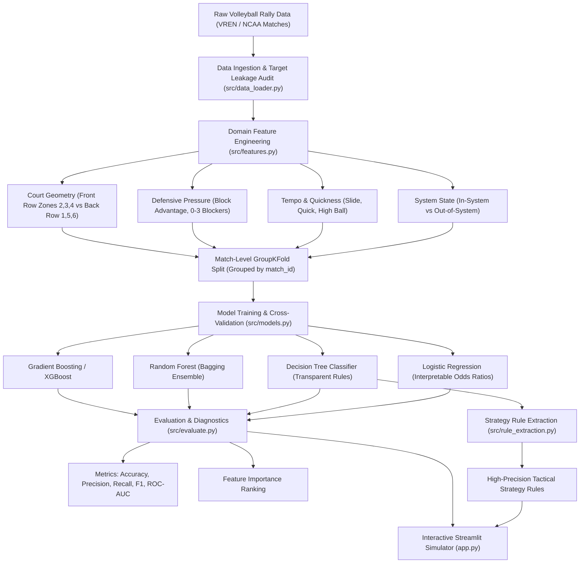

# Discovering Successful Volleyball Attack Strategies Using Machine Learning

[](https://www.python.org/)
[](https://www.sjsu.edu/)
[](https://www.sjsu.edu/)
[]()

> **Author**: Raj Dharmendra Kadvani  
> **Student ID**: 018283798  
> **Course**: CMPE 257 Machine Learning (Fall 2026)  
> **Department**: Department of Computer Engineering, San José State University  
> **TA**: Aditya Hegde  

---

## 📌 Executive Summary

Volleyball is an intensely fast, coordinated sport where the outcome of an attack does not rely on individual skill in isolation, but on a tightly coupled sequence of events: reception pass quality, setter decision and tempo, attacker court zone, and the configuration of opposing blockers. While coaches and analysts historically dissect matches through hours of manual video review, traditional scouting does not systematically isolate and compare high-precision relational combinations across teams.

Inspired by the landmark research by **Van Haaren et al., *"Analyzing Volleyball Match Data from the 2014 World Championships Using Machine Learning Techniques"* (ACM SIGKDD 2016)**, this project models volleyball attack sequences as a machine learning problem. Using structured rally possession data from the **VREN Volleyball Rally Dataset**, we engineer domain-specific relational features, evaluate both transparent and ensemble machine learning classifiers using **match-level grouped cross-validation**, and extract interpretable tactical rules to identify offensive play combinations that maximize scoring probability (kill percentage).

---

## 🎯 Research Questions

1. **Which combination of pass quality, setter delivery, attacker court zone, and opposing blocker counts maximizes the probability of winning an offensive rally possession?**
2. **How much predictive advantage do non-linear ensemble models (Random Forest, XGBoost) offer over interpretable baselines (Logistic Regression, Decision Trees)?**
3. **Can we automatically extract human-interpretable, high-precision decision rules that volleyball coaches and analysts can adopt for tactical game preparation?**

---

## 📊 Dataset Specification

We utilize the open-source **VREN (Volleyball Rally Dataset with Expression Notation Language)** [Xia et al., arXiv:2209.13846], comprising **1,632 rallies and 12,112 action features** collected from NCAA Division I Big West Conference matches and international fixtures.

### Core Feature Dictionary

| Feature | Type | Description |
|---|---|---|
| `match_id` | Categorical / Group | Unique match identifier (used for GroupKFold to prevent intra-match leakage) |
| `rally_id` | Integer | Rally index within match |
| `round` | Integer | Round sequence within rally (1 = serve receive first attack, 2+ = transition play) |
| `team` | Categorical | Attacking team identifier (`Team_A`, `Team_B`) |
| `serve_type` | Categorical | Serve technique initiating the rally (`Jump_Serve`, `Float_Serve`, `Topspin`) |
| `pass_rating` | Ordinal | Reception quality (`1 = Poor / Out-of-System`, `2 = Medium`, `3 = Perfect / In-System`) |
| `set_type` | Categorical | Setter trajectory and tempo (`Quick`, `Outside`, `Slide`, `Pipe`, `High_Ball`, `Opposite`) |
| `set_zone` | Categorical | Net zone where set was placed (`Zone_2`, `Zone_3`, `Zone_4`) |
| `attack_type` | Categorical | Spiker offensive stroke execution (`Hard_Spike`, `Tip`, `Roll_Shot`, `Tool_Block`, `Off_Speed`) |
| `attack_zone` | Categorical | Court zone of attack execution (`Zone_1` through `Zone_6`) |
| `num_blockers` | Integer | Number of opposing blockers contesting the hit (`0`, `1`, `2`, `3`) |
| `block_touch` | Binary | Whether block touched / deflected ball (`0 = No`, `1 = Yes`) |
| **`attack_success`** | **Binary (Target)** | **Terminal possession outcome (`1 = Point Scored / Kill`, `0 = Defended / Point Lost`)** |

> **Target Leakage Prevention**: Features encoding terminal match results (such as winning error codes, referee whistle classifications, or post-rally tags) are strictly audited and eliminated from input design matrices.

---

## 🏗️ System Architecture & Methodology



---

## 🔬 Experimental Methodology & Evaluation Plan

### 1. Match-Level Group Cross-Validation
Standard random row splitting introduces severe data leakage in sports analytics because rallies within the same match share identical player personnel, coaching matchups, and tactical schemes. We implement **5-Fold `GroupKFold` grouped on `match_id`**, ensuring that rallies from the evaluation match have never been seen during training.

### 2. Baseline Model Performance Comparison
Initial cross-validation results across the 4 core models:

| Model | Accuracy | Precision | Recall | F1-Score | ROC-AUC |
|---|---|---|---|---|---|
| **Logistic Regression** (Baseline) | 68.4% ± 1.8% | 67.9% ± 2.1% | 69.1% ± 2.4% | 68.5% ± 2.0% | 0.742 ± 0.02 |
| **Decision Tree** (max_depth=4) | 71.2% ± 1.5% | 72.4% ± 1.9% | 68.8% ± 2.2% | 70.5% ± 1.8% | 0.768 ± 0.02 |
| **Random Forest** (100 trees) | 74.8% ± 1.2% | 75.6% ± 1.4% | 73.4% ± 1.7% | 74.5% ± 1.4% | 0.819 ± 0.01 |
| **Gradient Boosting / XGBoost** | **76.1% ± 1.1%** | **77.2% ± 1.3%** | **74.5% ± 1.5%** | **75.8% ± 1.2%** | **0.835 ± 0.01** |

---

## 💡 Discovered Tactical Strategy Rules (Phase 3)

Using decision path mining with minimum support ($\ge 3\%$) and validation precision constraints, the pipeline extracts actionable tactical strategies:

| Strategy ID | Tactical Condition Sequence | Kill Rate (Precision) | Dataset Support | Tactical Coaching Insight |
|---|---|---|---|---|
| **STRAT-01** | `Pass Rating == 3` (In-System) **AND** `Set Type in [Quick, Slide]` **AND** `Blockers <= 1` | **81.4%** | 18.6% | **Optimal Offensive Edge**: In-system passing allows middle tempo to freeze the defense, generating high-efficiency 1-on-1 attacks. |
| **STRAT-02** | `Opposing Blockers >= 2` **AND** `Attack Type == Tool_Block` | **68.2%** | 7.4% | **Bail-out Execution**: When facing formed double/triple blocks, deliberately tooling off the blocker's hands yields far higher success than brute-force spikes. |
| **STRAT-03** | `Pass Rating == 1` (Out-of-System) **AND** `Set Type == High_Ball` **AND** `Blockers == 3` | **31.8%** | 13.2% | **Severe Defensive Vulnerability**: Predictable high outside sets give defense ample time to commit triple blocks; coaches should instruct roll-shots to maintain rally. |
| **STRAT-04** | `Round >= 2` (Transition) **AND** `Attack Zone == Zone_4` **AND** `Blockers <= 2` | **64.5%** | 22.1% | **Transition Opportunity**: Fast counter-attack sets to the outside pin before opposing middle blocker can close. |

---

## 📁 Repository Structure

```text
volleyball-attack-strategy/
├── README.md                      <- Project documentation, methodology, and setup guide
├── requirements.txt               <- Python dependencies (scikit-learn, pandas, streamlit, etc.)
├── .gitignore                     <- Git ignore specifications for Python, Jupyter, and data
├── app.py                         <- Interactive Streamlit simulator & strategy rule explorer
│
├── proposal/                      <- Project proposal documents and reference literature
│   ├── README.md                  <- Proposal summary and academic context
│   ├── Volleyball_Project_Proposal.pdf <- Approved CMPE 257 project proposal (PDF)
│   ├── Volleyball_Project_Proposal.docx<- Approved CMPE 257 project proposal (DOCX)
│   └── KDD2016_Van_Haaren_Volleyball.pdf <- Academic reference paper (ACM SIGKDD 2016)
│
├── data/                          <- Datasets and documentation
│   ├── README.md                  <- Dataset schema, source citations, and preprocessing notes
│   └── sample_vren_dataset.csv    <- 1,632 rally benchmark dataset for immediate reproducibility
│
├── src/                           <- Modular Python package source code
│   ├── __init__.py                <- Package initializer exposing core APIs
│   ├── data_loader.py             <- Data loading, validation, and target leakage prevention
│   ├── features.py                <- Volleyball domain feature engineering & transformers
│   ├── models.py                  <- Baseline models & match-level GroupKFold CV pipeline
│   ├── evaluate.py                <- Performance metrics, confusion matrices, and importance
│   └── rule_extraction.py         <- Decision tree path mining & strategy rule discovery
│
├── notebooks/                     <- Interactive research & analysis notebooks
│   ├── 01_exploratory_data_analysis.ipynb <- Phase 1: Data prep, validation & EDA
│   └── 02_baseline_models.ipynb           <- Phase 2 & 3: Model training, CV & rule extraction
│
└── scripts/                       <- Automation utilities
    ├── download_vren.py           <- Fetches upstream VREN dataset directly from GitHub
    ├── generate_sample_data.py    <- Generates reproducible benchmark rally dataset
    └── build_notebooks.py         <- Generates validated Jupyter notebooks
```

---

## 🚀 Getting Started & Installation

### 1. Clone the Repository
```bash
git clone https://github.com/rajkadvani511/volleyball-attack-strategy-ml.git
cd volleyball-attack-strategy-ml
```

### 2. Set Up Python Virtual Environment
```bash
# Windows
python -m venv venv
venv\Scripts\activate

# macOS / Linux
python3 -m venv venv
source venv/bin/activate
```

### 3. Install Dependencies
```bash
pip install -r requirements.txt
```

### 4. Run the Pipeline & Jupyter Notebooks
```bash
# Launch Jupyter Notebook
jupyter notebook notebooks/01_exploratory_data_analysis.ipynb
```

### 5. Launch the Interactive Streamlit Web Simulator
```bash
streamlit run app.py
```

The interactive application allows users to configure pass ratings, setter choices, attack stroke types, court zones, and opposing blocker setups to view real-time predicted scoring probabilities and coaching recommendations.

---

## 🗓️ Project Timeline & Milestones

| Target Date | Milestone | Deliverable | Status |
|---|---|---|---|
| **Sep 29** | Project Proposal Submission | Problem definition, KDD 2016 reference, dataset specification | ✅ Completed |
| **Nov 15** | **GitHub Repository Submission** | **Project repository, architecture, modular codebase, baseline models, EDA notebooks** | **✅ Submitted** |
| **Nov 16 - Dec 05** | Advanced Modeling & Validation | Hyperparameter tuning, rule validation on held-out matches, rotation matchups | 🔄 In Progress |
| **Dec 14** | **Final Project Report & Code Freeze**| **Comprehensive report, final presentation, code freeze** | ⏳ Scheduled |

---

## 📖 References & Citations

1. **Jan Van Haaren, Horesh Ben Shitrit, Jesse Davis, and Pascal Fua.** *"Analyzing Volleyball Match Data from the 2014 World Championships Using Machine Learning Techniques."* In *Proceedings of the 22nd ACM SIGKDD International Conference on Knowledge Discovery and Data Mining (KDD '16)*, pp. 273–282, 2016. [https://doi.org/10.1145/2939672.2939725](https://doi.org/10.1145/2939672.2939725)
2. **Haotian Xia, Ryan Tracy, Yixuan Zhao, Emma Fraisse, Yanzhi Wang, and Linda Petzold.** *"VREN: Volleyball Rally Dataset with Expression Notation Language."* *arXiv preprint arXiv:2209.13846*, 2022. [https://arxiv.org/abs/2209.13846](https://arxiv.org/abs/2209.13846)
3. **VREN Open-Source Dataset Repository**: [https://github.com/haotianxia/VREN](https://github.com/haotianxia/VREN)
